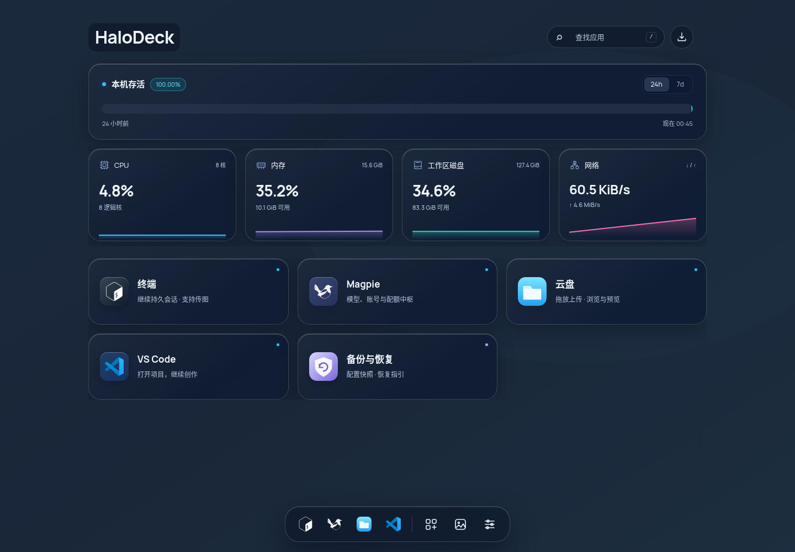

# HaloDeck

把浏览器变成自己的云端工作台：清爽的玻璃界面、真实系统状态、持久终端、文件管理、VS Code、Magpie，以及可带走数据的加密备份。

这是 Linux 上的个人浏览器工作站，不是操作系统发行版。当前发布支持 **Linux x86_64、Python 3.12+、Node 24.22.1、pnpm 10.34.6**；默认所有端口仅监听回环地址。适合单个可信所有者，不提供多人租户隔离。



## 包含什么

| 功能 | 实现 |
| --- | --- |
| 桌面与壁纸 | Homepage 2.7.0 + HaloDeck 主题，明暗适配、排序、搜索、手机布局、安装入口 |
| 状态与历史 | 本机内核资源采样、存活时间轴；缺数据就显示未知 |
| 浏览器终端 | ttyd + 独立 tmux 会话，支持图片上传到项目收件箱 |
| 代码与文件 | code-server、FileBrowser；文件入口限制在实例工作区，禁用文件管理器命令执行与分享 |
| 模型管理 | 独立 Magpie 实例；使用者自行配置模型和账号 |
| 备份与恢复 | restic + rclone，加密、去重、历史版本、SQLite 在线导出、FileBrowser 停写导出、独立恢复包 |
| 服务启动 | 随附 MIT 授权的 Revive 核心，统一登记；HaloDeck supervisor 负责自己的子进程 |

不包含个人账号、密钥、聊天记录、个人壁纸、任何现役数据库或 QQ Bot。上游应用在安装时从官方发行下载并校验 SHA-256，不把他人的应用二进制混进源码仓库。

## 安装

先安装 Git、Python 3.12+（含 venv）、Node 24.22.1、pnpm 10.34.6、tmux、基础编译工具。Homepage 首次构建需要联网与足够内存。以下命令用普通用户执行，不用 root：

```bash
git clone https://github.com/asashiki/halodeck.git
cd halodeck
python3 -m venv .venv
.venv/bin/pip install -r requirements.txt
.venv/bin/python scripts/manage.py init --hostname localhost
.venv/bin/python scripts/install.py
.venv/bin/python scripts/manage.py prepare-apps
.venv/bin/python scripts/manage.py register
.venv/bin/python integrations/revive/revive.py start halodeck
```

打开 **http://localhost:8100**。私有登录信息保存在 `~/.local/share/halodeck/private/login.txt`，请在自己的终端读取；不要提交到 GitHub。

远程 VPS 可先使用 SSH 转发：

```bash
ssh -L 8100:127.0.0.1:8100 YOUR_USER@YOUR_SERVER
```

源码留在 Git checkout，运行数据默认放 `~/.local/share/halodeck`。需要其他目录时，在**每次命令**前设置相同的 `HALODECK_HOME=/absolute/path`；首次 `init --port 18100` 可选择另外一组连续端口。不要把运行目录放进源码仓库。

[部署、域名和开机启动](docs/DEPLOYMENT.md) · [连接云盘与备份](docs/BACKUP.md) · [新机器恢复](docs/RECOVERY.md) · [给 Agent 的维护约定](AGENTS.md)

## 备份不会自动获得你的云盘权限

安装后备份显示“未配置”。需要使用自己的 rclone 配置和独立仓库，执行一次显式初始化、备份、导出恢复包并做恢复测试，随后再开启计划。默认每 **7 天**一次，失败隔 **24 小时**重试；可在私有 `settings.json` 调整，重启本实例后生效。没有自动删除云端版本的动作。

GitHub 保存的是安装配方；加密仓库保存你的实际数据；恢复包保存独立钥匙。三者不能相互替代。

## 验证范围

已在独立目录、独立端口和空账号配置下启动：桌面/手机布局、五个应用入口、鉴权与同源限制、配置编辑、加密快照及空目录恢复。依赖运行时复用了已校验的本机安装，**尚未在全新 VPS 从零构建所有依赖，未验证真实手机安装后的体验**。私人运行版另已做 Google Drive 真实数据恢复测试；公开版的发布验收使用隔离测试仓库，未附带任何私人授权。

FileBrowser 上游已归档，该组件仅放在回环地址并由统一鉴权保护；需要长期公网多人使用时请先评估替换方案。不要把后端端口直接开放到公网。详见 [安全边界](SECURITY.md)。

本项目 MIT；上游应用、字体和标识保留各自许可，见 [THIRD_PARTY.md](THIRD_PARTY.md)。
